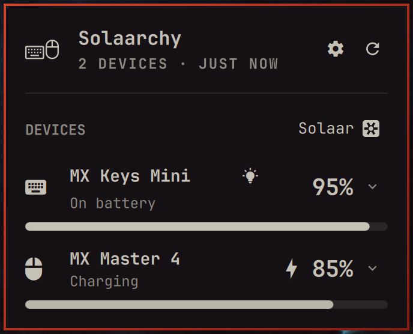
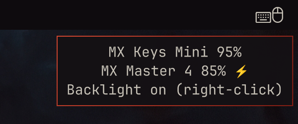
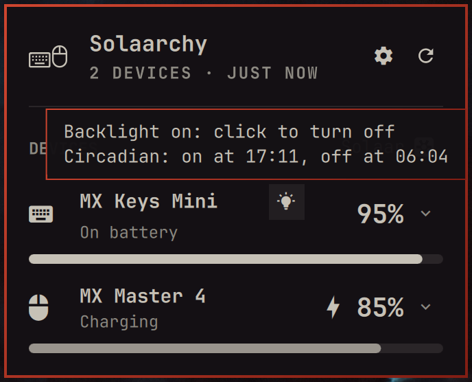
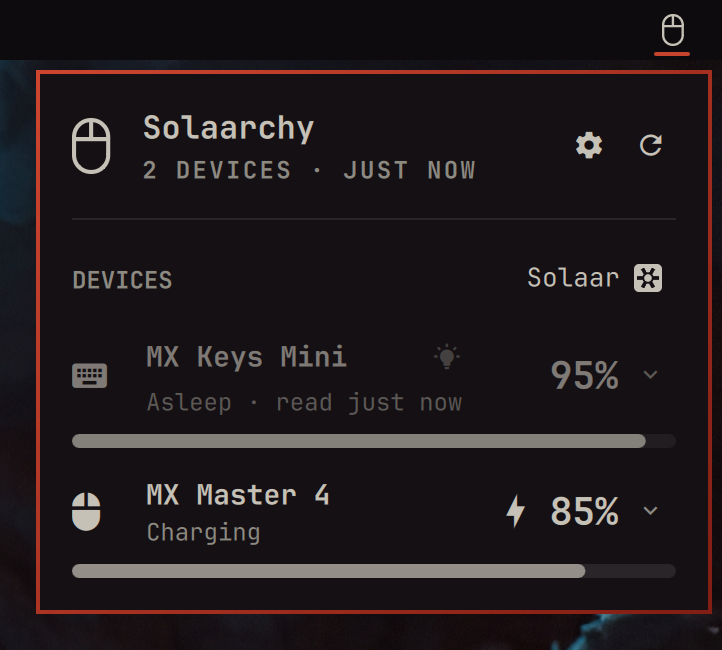
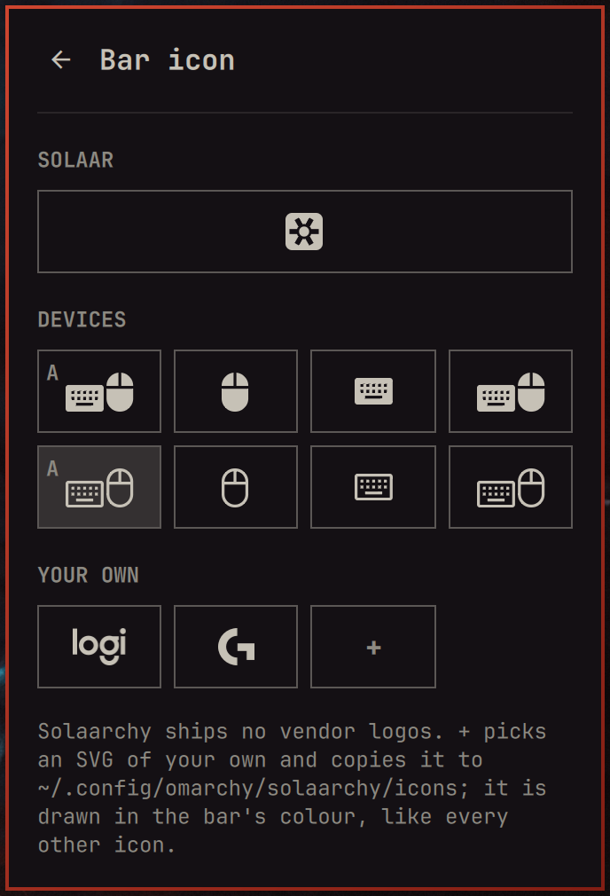

# Solaarchy

Every connected Logitech device at a glance, in the
[Omarchy](https://omarchy.org/) bar: how much battery each one has left, which
ones are awake, and the keyboard backlight — one click away, without opening an
app. Read through [Solaar](https://github.com/pwr-Solaar/Solaar).



- Battery level, charging state and a charge bar for each device
- Live updates: a device that switches off or goes to sleep shows as **Asleep**
  right away with its last reading; one that wakes, or a receiver plugged in or
  out, triggers a fresh read. No fast polling.
- One notification per discharge when a device drops below the low-battery
  threshold, one more at 5 %, and optionally when a device disconnects or
  comes back
- Keyboard backlight on/off: the bulb next to each keyboard's name, or
  right-click the bar icon
- **Dark hours**, a built-in add-on: every backlit keyboard lights up at civil
  dusk and goes dark at civil dawn, worked out offline for where you are
- A drawer per device: dark hours for that keyboard, hide the device, and what
  the device can do, grouped by capability as room for [add-ons](ADDONS.md)
- Settings in the panel, behind the gear; the bar icon picker behind the big
  icon; a one-click way to open Solaar
- The widget hides itself while no receiver is plugged in and no Logitech
  device is connected or paired over Bluetooth (optional)
- Last readings survive shell restarts

Solaarchy ships no vendor logos and is not affiliated with, or endorsed by,
Logitech or the Solaar project.

## Screenshots

<table>
  <tr>
    <td align="center" valign="top">
      <br>
      <sub>Hover the bar icon for every battery level at a glance</sub>
    </td>
    <td align="center" valign="top">
      <br>
      <sub>The bulb next to a keyboard switches its backlight</sub>
    </td>
  </tr>
  <tr>
    <td align="center" valign="top">
      <br>
      <sub>A sleeping keyboard keeps its last reading; bar icon: keyboard + mouse</sub>
    </td>
    <td align="center" valign="top">
      <br>
      <sub>Customise the bar icon: Solaar's own, a device icon, or any SVG you
      add yourself with <b>+</b></sub>
    </td>
  </tr>
</table>

The panel follows your Omarchy theme; these shots use several different ones.

## Requirements

- Omarchy with the Quattro shell
- **Solaar**, from the official Arch repositories:

  ```sh
  omarchy pkg add solaar
  ```

  It brings the Python library Solaarchy reads through and the udev rule that
  lets your user access Logitech receivers. Log out and back in (or replug the
  receiver) after installing it for the first time.

- Recommended: keep the Solaar app running in the background, so backlight
  changes are remembered and re-applied when the keyboard wakes. Add this to
  `~/.config/hypr/autostart.lua`:

  ```lua
  o.launch_on_start("solaar --window=hide")
  ```

## Install

```sh
omarchy plugin add https://github.com/C50NK4/Solaarchy.git --enable
```

## Usage

| On the bar icon | Does                               |
| --------------- | ---------------------------------- |
| Left-click      | Open or close the panel            |
| Right-click     | Toggle the keyboard backlight      |
| Middle-click    | Open Solaar                        |

In the panel:

- The **bulb** next to a keyboard's name switches its backlight.
- The **chevron** at the end of a device's row, or a click on the row, opens
  its drawer:
  - dark hours for that keyboard (follow or skip), when that built-in add-on
    is on
  - **Hide this device**, for a pairing you don't care about; Settings brings
    it back
  - a section per capability something fills, such as an
    [add-on](ADDONS.md), and the device's other capabilities on one line
- The **gear** opens Settings: the built-in add-ons, notifications, the bar,
  hidden devices, and the curated and other add-ons.
- The **big icon** opens the bar icon picker.
- **Solaar** on the DEVICES line opens Solaar, for pairing, buttons, DPI and
  everything else.

Arrow keys move between controls, Enter activates, and Escape goes back a
page or closes.

The panel can also be opened from a script:

```sh
omarchy-shell shell summon io.github.c50nk4.solaarchy '{}'
```

## Configure

Everything below is in the panel's Settings, and every setting can also be
set from the terminal:

```sh
omarchy bar set io.github.c50nk4.solaarchy icon mouse
omarchy bar set io.github.c50nk4.solaarchy lowThreshold 20
omarchy bar set io.github.c50nk4.solaarchy hideWhenDisconnected false --json
omarchy bar move io.github.c50nk4.solaarchy --section right
```

| Setting                | Default  | Meaning                                                                            |
| ---------------------- | -------- | ---------------------------------------------------------------------------------- |
| `icon`                 | `solaar` | Bar icon, see below                                                                |
| `customIcon`           | *(empty)*| File name of your own SVG, without `.svg`. Overrides `icon` while set              |
| `customIconDir`        | *(empty)*| Folder scanned for your own SVGs. Empty means `~/.config/omarchy/solaarchy/icons`  |
| `lowThreshold`         | `15`     | Battery % at or below which the icon turns urgent and a notification is sent      |
| `notifyLowBattery`     | `true`   | Notify once per discharge below `lowThreshold`                                     |
| `notifyCritical`       | `true`   | Notify once more at 5 %                                                            |
| `notifyConnection`     | `false`  | Notify when a device has had no link for 5 minutes, and when it comes back         |
| `refreshIntervalSec`   | `300`    | Backup poll. Connection changes are picked up immediately either way               |
| `hideWhenDisconnected` | `true`   | Hide the widget while no receiver is plugged in and no Logitech device is connected or paired over Bluetooth |
| `darkHours`            | `false`  | Built-in add-on: backlight on at civil dusk, off at civil dawn, see below          |
| `darkHoursOffset`      | `0`      | Minutes added to the dark hours on both ends (−120 to 120)                         |
| `darkHoursLocation`    | *(empty)*| `lat, lon` for dusk and dawn. Empty means your timezone's city                     |
| `devices`              | `{}`     | Per-device choices made in the drawers, by device id: `darkHours` (`false` skips), `hidden` |

Connected and disconnected notifications wait 5 minutes because Solaarchy
can't tell a device that fell asleep from one that was switched off; a
reconnect is only announced for a device whose disconnect was.

### Dark hours

Dark hours is a built-in add-on: Settings switches it on. Then every backlit
keyboard is switched on at civil dusk and off at civil dawn, when the sun is
6° below the horizon: the time it gets too dark to see the keys, a while after
sunset and before sunrise. The keyboard still decides by itself when to light
up, as when you switch it on by hand. Dark hours only make sure it is switched
on when you need it, for example when you sit down before dawn.

The dark hours page (the chevron next to its switch in Settings, or in a
keyboard's drawer) draws today as a 24-hour strip and sets the offset and the
location.

- A switch by hand, with the bulb or a right-click, holds until the next dusk
  or dawn.
- A keyboard's drawer can skip it: that keyboard keeps whatever light you
  give it while the rest follow.
- Dusk and dawn are worked out locally. With no `darkHoursLocation` the
  reference city of your timezone is used (Vienna for `Europe/Vienna`); set
  your own coordinates if you live far from it, since dusk moves with latitude
  as well as longitude.
- In polar night or white nights, when the sun stays below or above −6° all
  day, the backlight just stays on or off.
- The bulb's tooltip shows today's switch times.

```sh
omarchy bar set io.github.c50nk4.solaarchy darkHours true --json
omarchy bar set io.github.c50nk4.solaarchy darkHoursOffset 30 --json
omarchy bar set io.github.c50nk4.solaarchy darkHoursLocation "47.07, 15.44"
```

### Add-ons

Model-specific controls, such as haptics or lighting effects, are add-ons:
ordinary Omarchy plugins with a `solaarchy-addon.json` that puts their
controls into a device's drawer, or opens their own panel for that device.
[ADDONS.md](ADDONS.md) shows how to write one. Settings lists them in three
groups:

- **Built-in add-ons** come with Solaarchy: Dark hours.
- **Curated add-ons** have been reviewed for Solaarchy. They are listed even
  before you install them, with links to their repository and plugins.omarchy.org
  page.
- **Other add-ons** are any other installed plugin with a
  `solaarchy-addon.json`. They show up by themselves and work the same, but
  nobody has reviewed them.

An installed add-on's switch turns its plugin on or off in Omarchy, as
`omarchy plugin enable` and `disable` do. An add-on that is installed but
disabled gets nothing loaded.

### Bar icons

| Icons                                                              | Values                                                               |
| ------------------------------------------------------------------ | -------------------------------------------------------------------- |
| Solaar's own icon (default)                                        | `solaar`                                                             |
| Mouse, filled and outline                                          | `mouse`, `mouse-outline`                                             |
| Keyboard, filled and outline                                       | `keyboard`, `keyboard-outline`                                       |
| Keyboard + mouse, filled and outline                               | `combo`, `combo-outline`                                             |

Sources and licenses: [THIRD_PARTY.md](THIRD_PARTY.md).

### Your own bar icon

Solaarchy ships no vendor logos — no Logitech mark, no anyone else's. Those are
trademarks, and a plugin that hands them out is distributing artwork it has no
licence to, however small the icon is. Solaar itself takes the same line: it
uses the word "Logitech" to say what hardware it supports, and every icon it
ships is its own.

That leaves a real wish unserved: plenty of people are fond of their hardware
and want its mark in their own bar. So instead of shipping the artwork,
Solaarchy renders whatever SVG **you** supply.

Open the bar icon picker (the palette next to Refresh) and click **+** under
**YOUR OWN**. Pick an `.svg` file, and it is copied into
`~/.config/omarchy/solaarchy/icons/` and selected right away — no terminal, no
config file.

Every `.svg` in that folder is a tile of its own, so keep as many as you like
and switch between them in one click. Copying files in by hand works just as
well, and the folder is watched, so anything you add or remove shows up without
restarting the shell. From the terminal:

```sh
omarchy bar set io.github.c50nk4.solaarchy customIcon my-logo   # the file name, no .svg
omarchy bar set io.github.c50nk4.solaarchy customIcon ""        # back to the built-in icon
```

Notes:

- The icon takes your Omarchy theme's bar colour, exactly like every built-in
  icon, and turns urgent-red with the rest of the widget on low battery. So a
  single-colour silhouette works best: a multi-colour logo still renders, but
  as one solid shape.
- Proportions come from the file's `viewBox`, so a wide wordmark gets a wide
  slot instead of being squashed.
- What you put there is yours and stays on your machine. Using someone's
  trademark on your own desktop is your call; Solaarchy neither ships nor
  fetches it.

## Supported hardware

Developed and used daily with:

- **Bolt Receiver**
- **MX Keys Mini for Business** (battery + backlight)
- **MX Master 4** (battery)

Beyond that, anything Solaar can see:

- Bolt, Unifying, Nano, Lightspeed and 27 MHz receivers, with every device
  paired to them
- HID++ devices connected by USB cable or Bluetooth

Not supported: receivers Solaar doesn't know (some very basic Nano receivers,
such as the one sold with the M185) and Logitech devices without HID++ (plain
wired mice, most webcams and many headsets).

The backlight switch turns the backlight on or off. "On" is the first on-mode
Solaar offers for the keyboard: Automatic where the keyboard supports it,
otherwise Enabled or Manual. Brightness levels are left to the keyboard and
Solaar.

## How it works, and what it touches

Plugins run unsandboxed inside the Omarchy shell, so here is everything
Solaarchy does:

- **Reading devices:** `solaarchy-status.py` uses Solaar's Python library to
  ask each device for its battery and backlight state. It runs when the panel
  opens, after connection changes, and every `refreshIntervalSec`. The first
  time a device is seen awake it also reads its HID++ feature list (twice, to
  be sure), which is kept with the device so it is not asked again. It does not
  change any device setting and never writes Solaar's configuration. Reads are
  serialized with a lock file in a directory only you can write to
  (`$XDG_RUNTIME_DIR`, else `~/.cache/solaarchy`), never a shared one like
  `/tmp`, and every read is double-checked, because HID++ replies from other programs (the Solaar app
  included) can otherwise be mistaken for its own.
- **Watching connections:** `solaarchy-monitor.py` runs for as long as the
  widget is enabled. It opens the Logitech receivers' `/dev/hidraw*` nodes
  read-only and listens for connect/disconnect messages and USB hotplug
  events. It never writes to a device. The kernel stops it together with the
  shell.
- **Bluetooth pairings:** each read also asks BlueZ, read-only over the system
  bus (`busctl … GetManagedObjects`), how many Logitech devices are paired, so
  the widget stays while a Bluetooth keyboard sleeps.
- **Changing things:** only when you ask. Toggling the backlight runs
  `solaar config <device> backlight …`; with dark hours on, the same command
  runs once at dusk and once at dawn. `solaarchy-twilight.py` works out those
  times from your settings or your timezone, offline. Changing a setting in
  the panel, or picking a bar icon, runs `omarchy bar set …`. Opening Solaar
  runs `uwsm-app -- solaar`.
- **Add-ons:** when the panel opens, `solaarchy-addons.py` looks for
  `solaarchy-addon.json` in your installed plugins and asks the shell which
  are enabled. A drawer loads an enabled add-on's QML, and its button runs
  `omarchy-shell shell summon <add-on> …`. An add-on's switch in Settings runs
  `omarchy plugin enable|disable <add-on>`, and a curated add-on's links open
  with `xdg-open`.
- **Files:** last readings are saved to
  `~/.local/state/omarchy/solaarchy.json`. Settings live in
  `~/.config/omarchy/shell.json` like every bar widget's.
- **Notifications:** sent with `notify-send -a Solaarchy`.
- **Privileges:** none. No sudo, no udev rule or system service of its own;
  hardware access comes from Solaar's udev rule.

## Troubleshooting

- **"solaar library unavailable"**: Solaar isn't installed, see Requirements.
- **"could not open 046d:…: Permission denied"**: Solaar's udev rule hasn't
  applied yet. Replug the receiver or log out and back in.
- **The widget doesn't appear**: no receiver is plugged in, no Logitech device
  is connected or paired over Bluetooth, and `hideWhenDisconnected` is on. Run
  `omarchy plugin list --json | jq '.[] | select(.id == "io.github.c50nk4.solaarchy")'`
  to check that it's enabled, and `qs log -p "$OMARCHY_PATH/shell" --tail 100`
  for errors.
- **Backlight turns back on or off by itself**: the Solaar app is not
  running, or was running with a different saved setting. Start it as shown
  under Requirements.

## Update

```sh
omarchy plugin update io.github.c50nk4.solaarchy
```

## Remove

```sh
omarchy plugin remove io.github.c50nk4.solaarchy
rm -f ~/.local/state/omarchy/solaarchy.json
```

Removing the plugin stops the connection watcher with it. Solaar itself is
left installed.

To only take it off the bar and keep it installed:

```sh
omarchy plugin disable io.github.c50nk4.solaarchy
```

## License

Code: [MIT](LICENSE). Icons: see [THIRD_PARTY.md](THIRD_PARTY.md).
