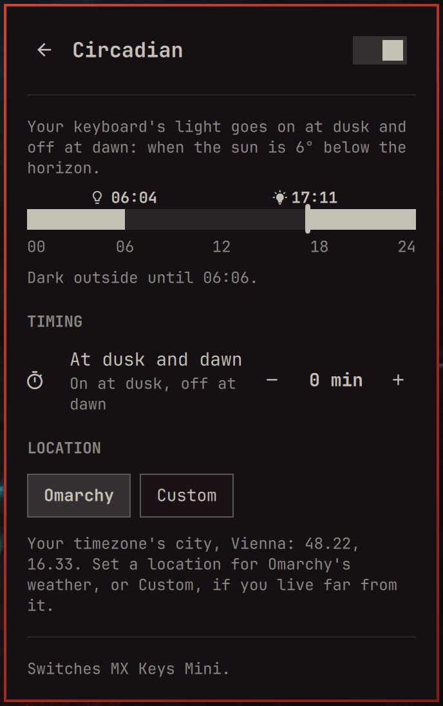
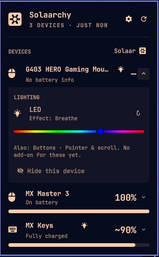

# Add-ons

Add-ons put extra controls into a device's drawer in Solaarchy's panel. To write
one, see [ADDONS.md](ADDONS.md).

| Add-on | Kind | For | What it does | Status | Screenshot |
|---|---|---|---|---|---|
| [Circadian](circadian/) | Built in | Backlit keyboards | Backlight on at civil dusk, off at civil dawn | On by default |  |
| [LED Effects](led/) | Built in | Mice with LED effects | A master switch on the row, one effect cycler for all zones, a hue slider | On by default; `RGB_EFFECTS` mice untested on hardware |  By @cbeaujoin |
| Haptics | Curated | MX Master 4 | Haptic feedback, as its own plugin | In development, nothing to install yet | – |

- **Built in:** ships with Solaarchy, switched on and off in Settings.
- **Curated:** reviewed for Solaarchy, and listed in Settings even before it's
  installed.
- **Community:** an installed plugin with a `solaarchy-addon.json` shows up in
  Settings by itself, marked as not reviewed.

## Add yours

Written an add-on? Open a pull request that adds a row with a link to its
repository, and **Community** as its kind. Getting it curated is a separate step,
described in [ADDONS.md](ADDONS.md).
